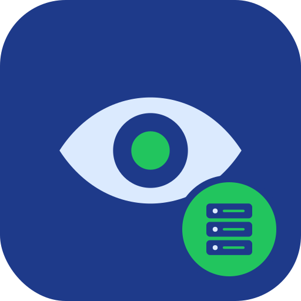

# aa-dev-prod-watcher

<p align="center">
  
</p>

React, TypeScript, Go and webpack solution to monitor and reivew upstream project commits

## Run method 1

Pull from Docker hub and run

```bash
# CORS and google-chrome

echo "127.0.0.1 localho.st" >> /etc/hosts

docker run -d --name docker.io/feeditout/scmwatcher -p 80.0.12280 -p 1323:1323 scm

# Open your web browser to http://localhost:8080
```

## Run method 2

Pull from Docker hub and run

```bash
# CORS and google-chrome

echo "127.0.0.1 localho.st" >> /etc/hosts

make docker-build

make docker-run

# Open your web browser to http://localhost:8080
```

## Run method 3

Run the applications locally

```bash
echo "127.0.0.1 localho.st" >> /etc/hosts

# console 1

make backend

# console 2

make frontend

# Open your web browser to http://localhost:8080
```


